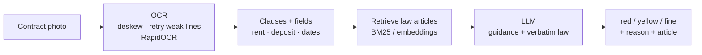

# Renewal Shield

**Photograph your Dubai tenancy contract. Find out which clauses break the law, and which to negotiate.**

**▶ Live demo:** https://renewal-shield.salmonrock-69923d13.germanywestcentral.azurecontainerapps.io/
(sleeps when idle: the first check after a while takes ~1 min to wake up)

Most tenants sign without reading the additional terms. Renewal Shield reads a phone photo of the
contract, splits out each clause, and checks it against Dubai tenancy law
(Law 26/2007 as amended by Law 33/2008, and Decree 43/2013):

- 🔴 **red**: likely conflicts with the law (e.g. *"terminates automatically if the property is sold"*)
- 🟡 **yellow**: legal but unfavourable, worth negotiating (e.g. *"tenant bears all repairs, regardless of cost"*)
- ✅ **fine**



## Results

On synthetic contracts (60 clause wordings, 6 categories), problem-vs-fine accuracy:

| Approach | Problem / fine | Severity |
|---|---|---|
| TF-IDF + logistic regression | 47% | 37% |
| GPT-4.1-mini, no law | 92% | 72% |
| GPT-4.1-mini + verbatim law (RAG) | 95% | 72% |
| **GPT-4.1-mini + guidance + verbatim law (hybrid)** | **98%** | **98%** |

OCR on 40 held-out phone photos: **98.9%** of clauses found, **99.4%** of fields (rent, deposit, dates) correct.

On **23 real phone photos** of printed contracts (sideways, angled, shadows, sent over WhatsApp):
20 read fully, **100%** of clauses found on those, **96%** problem/fine correct.

On the 14 official Ejari standard terms (real wording, all lawful): **0 false alarms**.

**Most interesting finding:** the LLM "knew" the 2007 eviction rule (90 days' notice) and kept applying
it even when a summary of the 2008 rule (12 months) was in the prompt. Only the verbatim article text overrode it.
Law text alone made it over-strict, though; combining it with practice guidance worked best.

→ Full numbers, findings and limitations: **[RESULTS.md](RESULTS.md)**

> All results are on synthetic data with labels still being verified. Not legal advice.

## Quick start

```bash
conda create -n renewal-shield python=3.11 -y && conda activate renewal-shield
pip install -r requirements.txt
cp .env.example .env                                   # add your OpenAI / Gemini key

python generate_contracts.py --n 10                    # synthetic contracts → out/
python ocr_pipeline.py --image out/photo/contract_0001.png
python law_index.py --build                            # law PDFs → article index
python classify_llm.py --provider openai --mode hybrid --ocr-dir out
python classify_llm.py --compare

python check_contract.py --image out/photo/contract_0001.png   # one contract -> report
uvicorn app:app --reload                                       # web app -> http://127.0.0.1:8000
```

**Deploy:** every push builds a Docker image with GitHub Actions (`.github/workflows/build-image.yml`);
`deploy_azure.ps1` points Azure Container Apps at it. The OpenAI key is an Azure secret; the app limits
visitors (5 photos/hour each, 150 checks/day in total) so a public link can't run up the API bill.

## Project structure

| File | What it does |
|---|---|
| `renewal_shield_clause_bank_v0.3.xlsx` | 60 labelled clauses: category, problem/fine, severity, law reference |
| `generate_contracts.py` | Synthetic contracts: clean scans + phone-style photos + JSON labels |
| `ocr_pipeline.py` | Photo → clauses + fields, with evaluation (`--rescore` re-scores saved output) |
| `classify_baseline.py` | TF-IDF baseline, leave-one-clause-out evaluation |
| `law_index.py` | Consolidated law index (2008 amendments replace 2007 text) + BM25/embedding retrieval |
| `check_contract.py` | One contract end to end: photo → OCR → hybrid check → red/yellow/fine report (Markdown + JSON) |
| `app.py`, `static/` | FastAPI web app: upload a photo, see the report; API docs at `/docs` |
| `classify_llm.py` | LLM classifier: `zero` · `law` · `rag` · `oracle` · `hybrid`; OpenAI, Gemini, Anthropic, Ollama |
| `law/` | Official law texts (EN/AR) and the built article index |
| `results/` | Predictions, cached LLM answers, comparison table |

## Status

- [x] Clause bank + synthetic contract generator
- [x] OCR pipeline (clean + photo)
- [x] Baseline, LLM and RAG classifiers; benchmark
- [ ] Verify all labels against the law
- [ ] Second LLM (Gemini) + real redacted contracts as a test set
- [x] Web app: FastAPI + upload page
- [x] Deploy: Azure Container Apps, image built by GitHub Actions
- [ ] Cite the article the model relied on (prompt v4)
- [ ] Arabic contracts and Arabic/English mismatch check

## Tech

Python · FastAPI · Docker · Azure Container Apps · GitHub Actions · RapidOCR · Tesseract · scikit-learn · OpenAI / Gemini APIs · BM25 & embedding retrieval · pandas · Pillow
